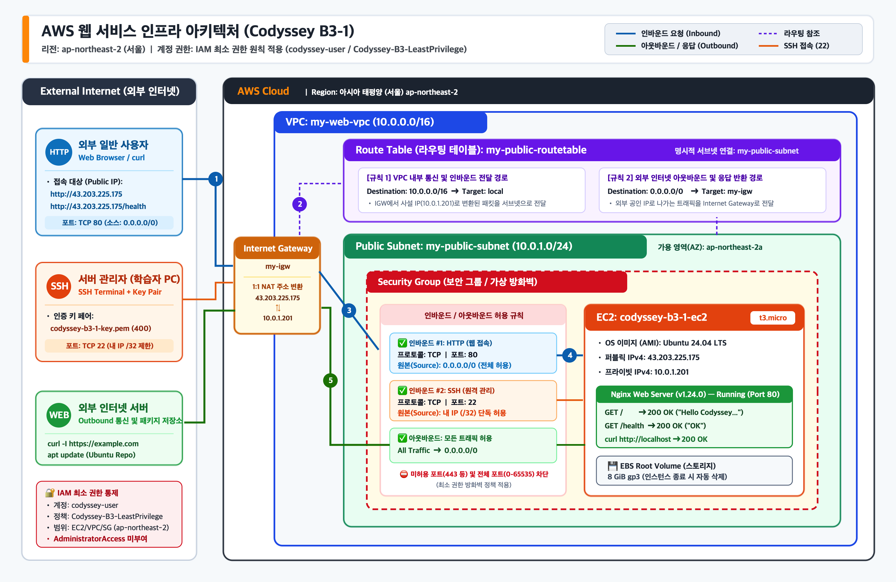
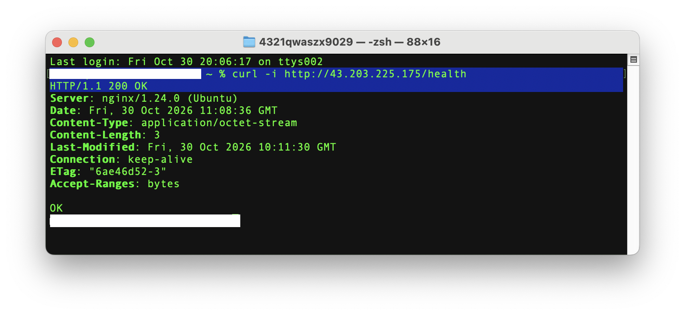

# Codyssey-B3-1: 내가 만든 웹사이트를 인터넷에 올려 누구나 쓰게 하기

AWS 클라우드 환경(서울 리전 `ap-northeast-2`)에서 격리된 네트워크(**VPC, Public Subnet, Internet Gateway, Route Table**)를 직접 설계하고, **보안 그룹(Security Group)** 및 **IAM 최소 권한 원칙**을 적용하여 **EC2(Ubuntu 24.04 LTS) + Nginx 웹 서비스**를 구축한 프로젝트입니다.

---

## 📌 최종 결과물 바로가기

| 번호 | 제출 항목 | 문서 / 파일 링크 |
| :---: | :--- | :--- |
| **1** | **아키텍처 다이어그램** | [`docs/architecture.png`](./docs/architecture.png) |
| **2** | **웹 서비스 외부 접속 증빙** | 본 문서 하단 [4. 외부 접속 검증](#4-외부-접속-검증) 참조 |
| **3** | **트러블슈팅 보고서** | [`docs/troubleshooting.md`](./docs/troubleshooting.md) |
| **4** | **리소스 정리 체크리스트** | [`docs/cleanup-checklist.md`](./docs/cleanup-checklist.md) |

---

## 1. 아키텍처 다이어그램 및 인프라 구성 요약



| 구분 | 리소스 이름 | 설정값 / 세부 내용 |
| :--- | :--- | :--- |
| **리전 (Region)** | 서울 리전 | `ap-northeast-2` (가용 영역: `ap-northeast-2a`) |
| **IAM 권한** | `codyssey-user` | `Codyssey-B3-LeastPrivilege` (서울 리전 EC2/VPC/SG 최소 권한 부여, `AdministratorAccess` 미부여) |
| **VPC** | `my-web-vpc` | IPv4 CIDR `10.0.0.0/16` |
| **Subnet** | `my-public-subnet` | IPv4 CIDR `10.0.1.0/24` (Public Subnet) |
| **Internet Gateway** | `my-igw` | `my-web-vpc`에 연결 (`Attached`) |
| **Route Table** | `my-public-routetable` | `10.0.0.0/16 ➔ local` / `0.0.0.0/0 ➔ my-igw` (`my-public-subnet` 명시적 연결) |
| **Security Group** | 보안 그룹 | • 인바운드: `HTTP (TCP 80) ➔ 0.0.0.0/0`, `SSH (TCP 22) ➔ 내 IP(/32)`<br/>• 아웃바운드: `All Traffic ➔ 0.0.0.0/0` (전체 포트 `0-65535` 인바운드 허용 규칙 미생성) |
| **EC2 인스턴스** | `codyssey-b3-1-ec2` | `t3.micro` / Ubuntu 24.04 LTS / EBS `8 GiB (gp3)`<br/>• 퍼블릭 IPv4: `43.203.225.175` / 프라이빗 IPv4: `10.0.1.201` |

### 1-2. IAM 최소 권한 정책 상세 (`Codyssey-B3-LeastPrivilege`)

루트 계정이나 관리자 권한(`AdministratorAccess`), 또는 범위가 넓은 `FullAccess` 관리형 정책 대신, 실습에 필요한 작업만 선별하고 생성/변경 작업을 **서울 리전(`ap-northeast-2`)으로만 제한**한 사용자 지정 최소 권한 정책을 적용했습니다.

| 정책 블록 (`Sid`) | 분류 / 목적 | 허용된 세부 권한 (`Action`) | 리전 제한 (`Condition`) | 최소 권한 적용 근거 (제외된 권한) |
| :--- | :--- | :--- | :---: | :--- |
| **`AllowConsoleReadOnlyAndAmiLookup`** | 콘솔 리소스 조회 및<br/>Ubuntu AMI 조회 | • **EC2/VPC 조회**: `ec2:Describe*`, `ec2:GetConsoleOutput`, `ec2:GetConsoleScreenshot`<br/>• **AMI 파라미터 조회**: `ssm:GetParameter`, `ssm:GetParameters`, `ssm:DescribeParameters` | 전체 (`*`)<br/>*(읽기 전용)* | 콘솔 UI 렌더링 및 OS 이미지 선택에 필요한 읽기 전용 권한만 허용 (리소스 변경 불가) |
| **`AllowMissionVpcNetworkInSeoulOnly`** | VPC 네트워크 구성<br/>(VPC, Subnet, IGW, RT) | • **VPC**: `CreateVpc`, `ModifyVpcAttribute`, `DeleteVpc`<br/>• **Subnet**: `CreateSubnet`, `ModifySubnetAttribute`, `DeleteSubnet`<br/>• **IGW**: `CreateInternetGateway`, `AttachInternetGateway`, `DetachInternetGateway`, `DeleteInternetGateway`<br/>• **Route Table**: `CreateRouteTable`, `CreateRoute`, `ReplaceRoute`, `DeleteRoute`, `AssociateRouteTable`, `DisassociateRouteTable`, `DeleteRouteTable` | `ap-northeast-2`<br/>(서울 리전 전용) | 고과금 위험이 있는 **NAT Gateway, Transit Gateway, VPN 생성 권한 원천 배제** 및 타 리전 생성 차단 |
| **`AllowMissionSecurityGroupInSeoulOnly`** | 보안 그룹(방화벽) 및<br/>인/아웃바운드 규칙 관리 | • **보안 그룹**: `CreateSecurityGroup`, `DeleteSecurityGroup`<br/>• **규칙 설정**: `AuthorizeSecurityGroupIngress`, `RevokeSecurityGroupIngress`, `AuthorizeSecurityGroupEgress`, `RevokeSecurityGroupEgress`, `ModifySecurityGroupRules` | `ap-northeast-2`<br/>(서울 리전 전용) | 실습 보안 그룹 생성 및 포트(80, 22) 규칙 제어 권한만 허용 |
| **`AllowMissionEc2ComputeAndTaggingInSeoulOnly`** | EC2 인스턴스, 키페어,<br/>EBS 볼륨, 태그 관리 | • **태그/키페어**: `CreateTags`, `DeleteTags`, `CreateKeyPair`, `DeleteKeyPair`<br/>• **인스턴스**: `RunInstances`, `StartInstances`, `StopInstances`, `RebootInstances`, `TerminateInstances`<br/>• **EBS 볼륨**: `CreateVolume`, `AttachVolume`, `DetachVolume`, `ModifyVolume`, `DeleteVolume`<br/>• **네트워크 인터페이스/IP**: `Create/Delete/Modify/Attach/DetachNetworkInterface`, `Allocate/Associate/Disassociate/ReleaseAddress` | `ap-northeast-2`<br/>(서울 리전 전용) | 로드밸런서(ELB), Auto Scaling, Spot Fleet 및 무관한 서비스(**S3, RDS 등**) 권한 일절 배제 |
| **`AllowBillingDashboardReadOnly`** | 과금 방지 확인용<br/>Billing 대시보드 조회 | • `aws-portal:View*`, `billing:Get*`, `ce:Get*`, `ce:Describe*`, `freetier:Get*` | 전체 (`*`)<br/>*(읽기 전용)* | 리소스 정리 후 과금 여부를 확인하기 위한 조회 권한만 허용 (결제 설정 변경 불가) |

---

## 2. SSH 원격 접속 및 아웃바운드 통신 검증

키 페어(`codyssey-b3-1-key.pem`) 권한을 `400`으로 설정한 뒤 EC2 인스턴스에 SSH로 접속하고, Public Subnet에서 외부 인터넷으로의 아웃바운드 통신(`curl -I https://example.com`)이 정상 동작함을 확인했습니다.

```text
>>> user@local ~ % cd Downloads         

>>> user@local Downloads % chmod 400 codyssey-b3-1-key.pem  

>>> user@local Downloads % ssh -i codyssey-b3-1-key.pem ubuntu@43.203.225.175
The authenticity of host '43.203.225.175 (43.203.225.175)' can't be established.
ED25519 key fingerprint is SHA256:F02sQRtKZ536kwpXBWAe95I+U8CrJzHTkiXrz1BxwSQ.
This key is not known by any other names.
Are you sure you want to continue connecting (yes/no/[fingerprint])? yes
Warning: Permanently added '43.203.225.175' (ED25519) to the list of known hosts.
Welcome to Ubuntu 24.04.5 LTS (GNU/Linux 7.0.0-1014-aws x86_64)

 * Documentation:  https://help.ubuntu.com
 * Management:     https://landscape.canonical.com
 * Support:        https://ubuntu.com/pro

 System information as of Fri Oct 30 10:00:24 UTC 2026

  System load:  0.03              Temperature:           -273.1 C
  Usage of /:   29.6% of 6.71GB   Processes:             122
  Memory usage: 25%               Users logged in:       0
  Swap usage:   0%                IPv4 address for ens5: 10.0.1.201

>>> ubuntu@ip-10-0-1-201:~$ curl -I https://example.com
HTTP/2 200 
date: Fri, 30 Oct 2026 10:00:51 GMT
content-type: text/html; charset=utf-8
server: cloudflare
last-modified: Thu, 29 Oct 2026 13:15:03 GMT
allow: GET, HEAD
accept-ranges: bytes
age: 9856
cf-cache-status: HIT
cf-ray: a52993493c84d2c4-ICN
alt-svc: h3=":443"; ma=86400
```

---

## 3. 웹 서버(Nginx) 설치 및 실행하기

### 3-1. Nginx 설치

```text
>>> ubuntu@ip-10-0-1-201:~$ sudo apt update
Hit:1 http://ap-northeast-2.ec2.archive.ubuntu.com/ubuntu noble InRelease
Get:2 http://ap-northeast-2.ec2.archive.ubuntu.com/ubuntu noble-updates InRelease [126 kB]
~생략~
Get:50 http://security.ubuntu.com/ubuntu noble-security/multiverse amd64 c-n-f Metadata [468 B]
Fetched 35.8 MB in 6s (6346 kB/s)                                    
Reading package lists... Done
Building dependency tree... Done
Reading state information... Done
18 packages can be upgraded. Run 'apt list --upgradable' to see them.

>>> ubuntu@ip-10-0-1-201:~$ sudo apt install -y nginx
Reading package lists... Done
Building dependency tree... Done
Reading state information... Done
The following additional packages will be installed:
  nginx-common
Suggested packages:
  fcgiwrap nginx-doc ssl-cert
The following NEW packages will be installed:
  nginx nginx-common
0 upgraded, 2 newly installed, 0 to remove and 18 not upgraded.
Need to get 570 kB of archives.
After this operation, 1602 kB of additional disk space will be used.
Get:1 http://ap-northeast-2.ec2.archive.ubuntu.com/ubuntu noble-updates/main amd64 nginx-common all 1.24.0-2ubuntu7.19 [45.3 kB]
Get:2 http://ap-northeast-2.ec2.archive.ubuntu.com/ubuntu noble-updates/main amd64 nginx amd64 1.24.0-2ubuntu7.19 [525 kB]
Fetched 570 kB in 0s (18.5 MB/s)
Preconfiguring packages ...
Selecting previously unselected package nginx-common.
(Reading database ... 79249 files and directories currently installed.)
Preparing to unpack .../nginx-common_1.24.0-2ubuntu7.19_all.deb ...
Unpacking nginx-common (1.24.0-2ubuntu7.19) ...
Selecting previously unselected package nginx.
Preparing to unpack .../nginx_1.24.0-2ubuntu7.19_amd64.deb ...
Unpacking nginx (1.24.0-2ubuntu7.19) ...
Setting up nginx-common (1.24.0-2ubuntu7.19) ...
Created symlink /etc/systemd/system/multi-user.target.wants/nginx.service → /usr/lib/systemd/system/nginx.service.
Setting up nginx (1.24.0-2ubuntu7.19) ...
 * Upgrading binary nginx                                                    [ OK ] 
```

### 3-2. Nginx 실행 및 인스턴스 내부(`localhost`) 응답 확인

```text
>>> ubuntu@ip-10-0-1-201:~$ sudo systemctl status nginx
● nginx.service - A high performance web server and a reverse proxy server
     Loaded: loaded (/usr/lib/systemd/system/nginx.service; enabled; preset: enable>
     Active: active (running) since Fri 2026-10-30 10:06:53 UTC; 25s ago
       Docs: man:nginx(8)
    Process: 1734 ExecStartPre=/usr/sbin/nginx -t -q -g daemon on; master_process o>
    Process: 1736 ExecStart=/usr/sbin/nginx -g daemon on; master_process on; (code=>
   Main PID: 1765 (nginx)
      Tasks: 3 (limit: 627)
     Memory: 2.4M (peak: 5.0M)
        CPU: 29ms
     CGroup: /system.slice/nginx.service
             ├─1765 "nginx: master process /usr/sbin/nginx -g daemon on; master_pro>
             ├─1768 "nginx: worker process"
             └─1769 "nginx: worker process"

Oct 30 10:06:53 ip-10-0-1-201 systemd[1]: Starting nginx.service - A high performan>
Oct 30 10:06:53 ip-10-0-1-201 systemd[1]: Started nginx.service - A high performanc>

>>> ubuntu@ip-10-0-1-201:~$ echo "<h1>Hello Codyssey B3-1 Mission</h1>" | sudo tee /var/www/html/index.html
<h1>Hello Codyssey B3-1 Mission</h1>

>>> ubuntu@ip-10-0-1-201:~$ echo "OK" | sudo tee /var/www/html/health
OK

>>> ubuntu@ip-10-0-1-201:~$ curl -i http://localhost
HTTP/1.1 200 OK
Server: nginx/1.24.0 (Ubuntu)
Date: Fri, 30 Oct 2026 10:11:51 GMT
Content-Type: text/html
Content-Length: 37
Last-Modified: Fri, 30 Oct 2026 10:10:56 GMT
Connection: keep-alive
ETag: "6ae46d30-25"
Accept-Ranges: bytes

<h1>Hello Codyssey B3-1 Mission</h1>
```

---

## 4. 외부 접속 검증

외부 접속 검증 요구사항인 **방식 (A) 브라우저 접속**과 **방식 (B) `/health` 헬스체크 호출** 두 가지 모두 수행하여 정상 응답(`200 OK`)을 확인했습니다.

* **선택한 검증 방식**: **(A)** 브라우저로 `http://<퍼블릭IP>` 접속 및 **(B)** `GET http://<퍼블릭IP>/health` 호출 (모두 검증)
* **접속 정보 (퍼블릭 IP / URL)**:
  * 퍼블릭 IPv4: `43.203.225.175`
  * 방식 (A) URL: `http://43.203.225.175`
  * 방식 (B) URL: `http://43.203.225.175/health`

### 4-1. 방식 (A) 웹 브라우저 접속 (`http://43.203.225.175`)
외부 웹 브라우저에서 `http://43.203.225.175` 접속 시 설정한 웹 페이지(`Hello Codyssey B3-1 Mission`)가 정상적으로 표시됨을 확인했습니다.


### 4-2. 방식 (B) `/health` 호출 (`GET http://43.203.225.175/health`)
외부 로컬 터미널에서 `curl -i http://43.203.225.175/health` 호출 시 `HTTP/1.1 200 OK` 상태 코드와 함께 고정 응답인 `OK`가 반환됨을 확인했습니다.


