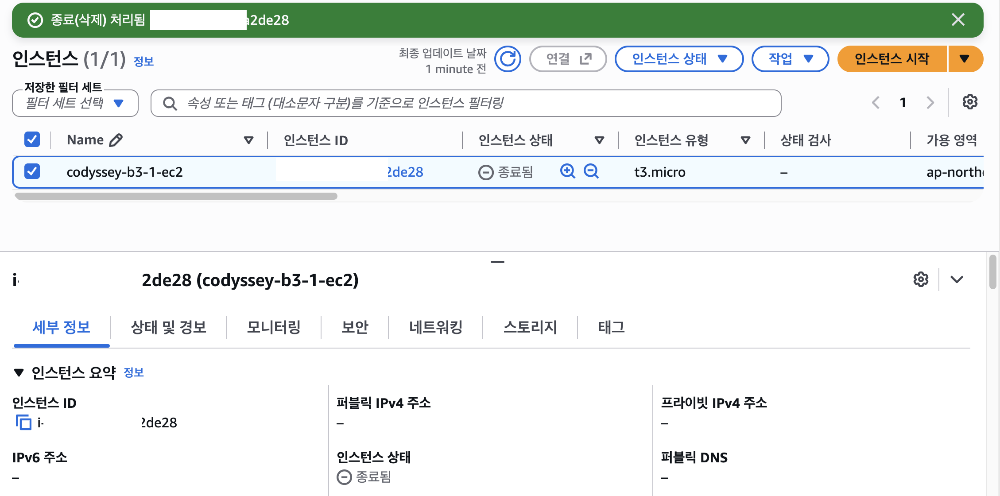
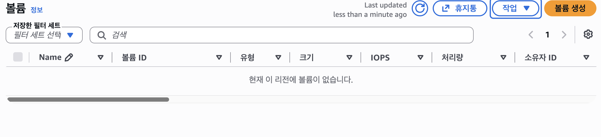
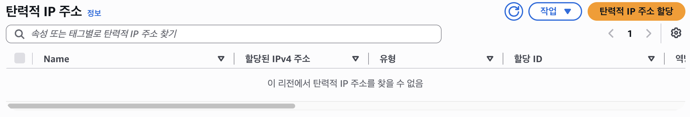
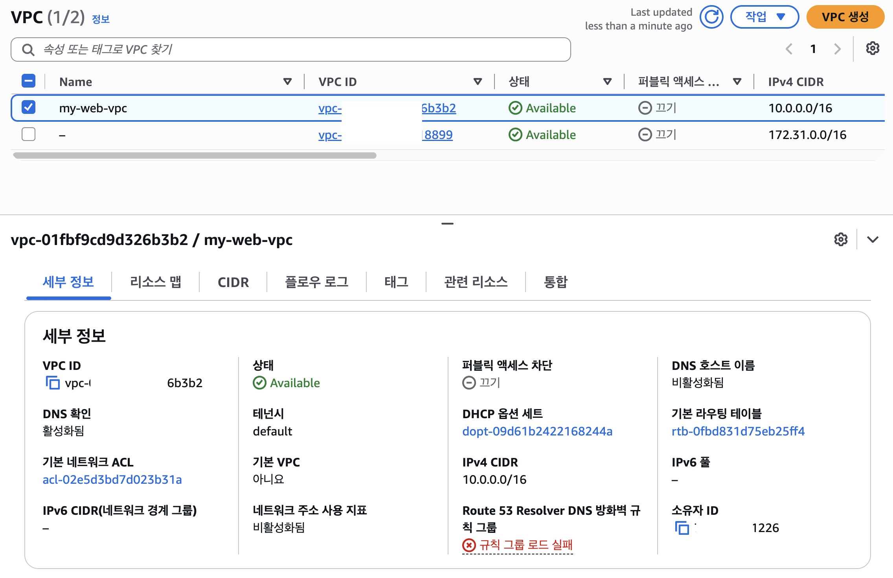
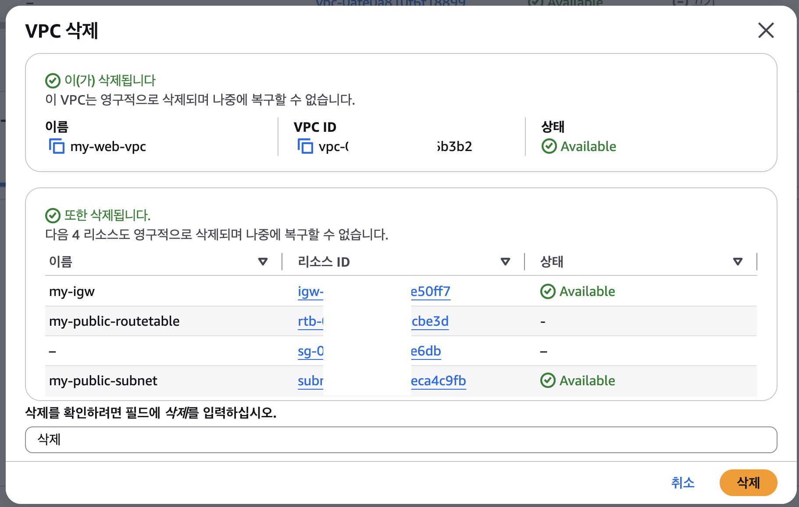
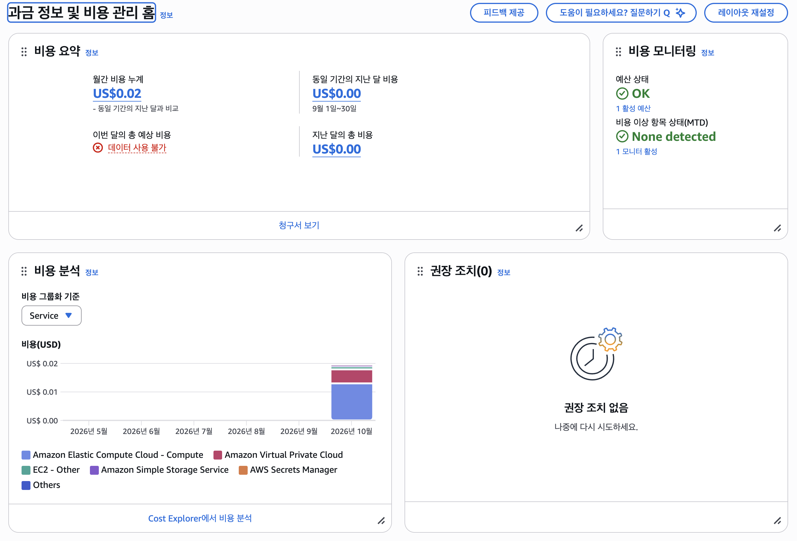
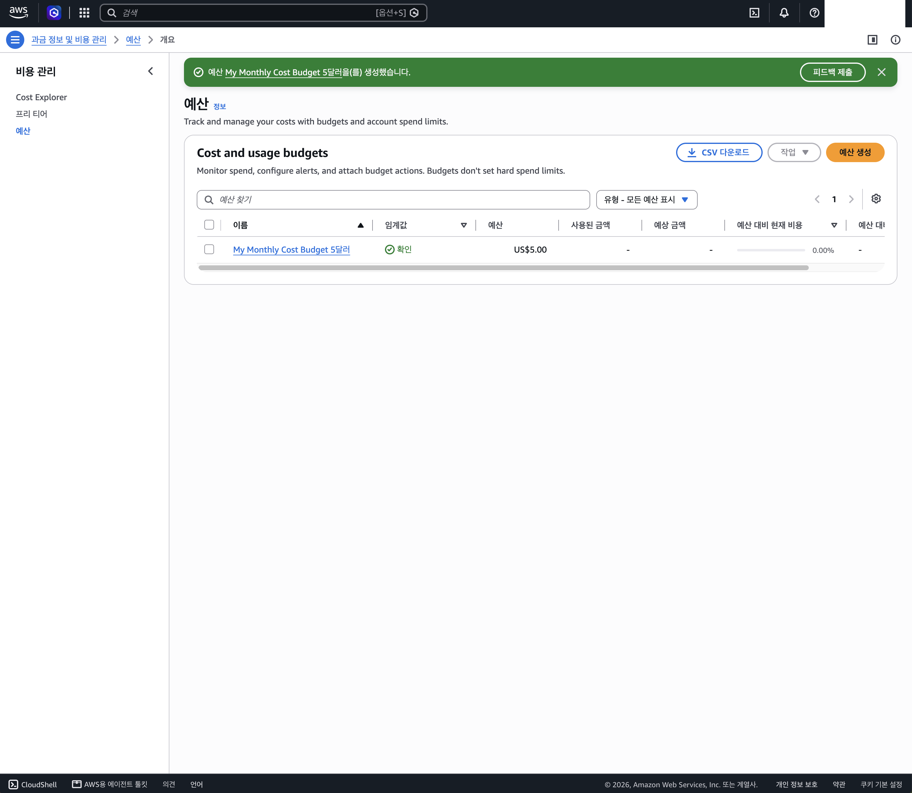

# 🧹 리소스 정리 체크리스트 (Cleanup Checklist)

실습 종료 후 추가 과금이 발생하지 않도록 의존성 순서(**EC2 ➔ EBS ➔ Elastic IP ➔ VPC**)에 따라 리소스를 정리하고, 각 항목의 삭제 및 상태를 검증한 기록입니다.

---

## 1. 리소스 정리 요약 체크리스트

- [x] **1. EC2 인스턴스 `종료됨(Terminated)` 상태 확인** (`codyssey-b3-1-ec2`)
- [x] **2. EBS 볼륨(미사용 볼륨 포함) 전체 삭제 확인** (`현재 이 리전에 볼륨이 없습니다`)
- [x] **3. Elastic IP (탄력적 IP) 미할당 / Release 상태 확인** (`원래 생성하지 않음 — 탄력적 IP 주소 없음 확인`)
- [x] **4. VPC 삭제 및 하위 네트워크 리소스(Subnet, Route Table, IGW, Security Group) 정리 확인** (`my-web-vpc`)
  - *참고*: `Route Table`, `Subnet`, `Internet Gateway` 자체는 별도 과금 대상이 아니므로 개별 메뉴에서 수동 삭제하지 않았으며, AWS 콘솔에서 `VPC 삭제` 진행 시 종속된 4개 리소스(`my-igw`, `my-public-routetable`, `Security Group`, `my-public-subnet`)가 함께 삭제 대상으로 처리됨을 확인함.
- [x] **(해당 시) 고과금 리소스 미생성 확인**: NAT Gateway, ELB/ALB, RDS 생성하지 않음 (IAM 최소 권한 정책에서도 생성 차단)
- [x] **(권장) Billing Dashboard 및 예산(Budgets) 알림 확인 완료**

---

## 2. 리소스 정리 순서 및 이유

클라우드 리소스는 서로 의존 관계(Dependency)가 존재하며, 과금 구조가 다르기 때문에 아래 순서로 정리를 진행했습니다.

| 순서 | 정리 대상 | 과금 여부 및 위험 요인 | 조치 내용 |
| :---: | :--- | :--- | :--- |
| **1순위** | **EC2 인스턴스** | 실행(`Running`) 시간당 컴퓨팅 요금 및 퍼블릭 IPv4 시간당 요금 발생 | 단순 중지(`Stop`)가 아닌 **`인스턴스 종료(Terminate)`** 수행 |
| **2순위** | **EBS 볼륨** | 인스턴스가 중지되어도 할당된 스토리지 용량(GB/월)만큼 요금 발생 | EC2 종료와 함께 자동 삭제되어 남은 볼륨이 `0개`인지 확인 |
| **3순위** | **Elastic IP** | 원래 할당받지 않음 (할당 후 미연결 방치 시 시간당 요금 발생) | 리전 내 할당된 탄력적 IP가 없음을 확인 |
| **4순위** | **VPC (및 하위 네트워크)** | VPC, Subnet, Route Table, IGW, Security Group 자체는 무료 | `my-web-vpc` 삭제 수행 (하위 `IGW`, `Route Table`, `Subnet`, `SG` 일괄 정리 확인) |

---

## 3. 단계별 리소스 정리 증빙 스크린샷

### Step 1. EC2 인스턴스 종료 (`Terminated`) 확인
* `codyssey-b3-1-ec2` 인스턴스를 종료(Terminate) 처리하여 인스턴스 상태가 **`종료됨`**으로 변경되고 퍼블릭 IPv4 주소가 반납된 것을 확인했습니다.

---

### Step 2. EBS 볼륨 삭제 확인
* EC2 종료 후 **[Elastic Block Store] ➔ [볼륨]** 메뉴에서 미사용(`Available`) 상태로 남아있는 볼륨 없이 **`현재 이 리전에 볼륨이 없습니다.`** 상태임을 확인했습니다.

---

### Step 3. Elastic IP (탄력적 IP) 확인
* 실습 과정에서 별도의 탄력적 IP를 할당받지 않았으며, **[탄력적 IP]** 메뉴에서 **`이 리전에서 탄력적 IP 주소를 찾을 수 없음`**을 확인했습니다.

---

### Step 4. VPC 삭제 (`my-web-vpc`)
* `Route Table`, `Subnet`, `Internet Gateway`는 그 자체로 과금되지 않는 무료 리소스이므로 개별 메뉴에서 별도로 삭제하지 않고, 상위 **`my-web-vpc`** 삭제를 진행했습니다.
* AWS 콘솔에서 `my-web-vpc` 삭제 시 하위 종속 리소스인 **`my-igw`**, **`my-public-routetable`**, **보안 그룹(`sg-...`)**, **`my-public-subnet`** 4개 항목도 함께 영구 삭제됨을 확인했습니다.

* **VPC 선택 및 상태 확인**
  

* **VPC 및 하위 리소스 일괄 삭제 확인**
  

---

### Step 5. 과금 정보 및 예산(Billing & Budgets) 확인
* 모든 과금 대상 리소스(EC2, EBS) 정리 후 **과금 정보 및 비용 관리 홈(Billing Dashboard)**과 **예산(Budgets, 월 $5 한도 알림)** 설정을 통해 추가 과금 위험이나 이상 항목(`None detected`)이 없음을 최종 확인했습니다.

* **Billing Dashboard 확인**
  

* **AWS Budgets 예산 한도 설정 확인**
  

