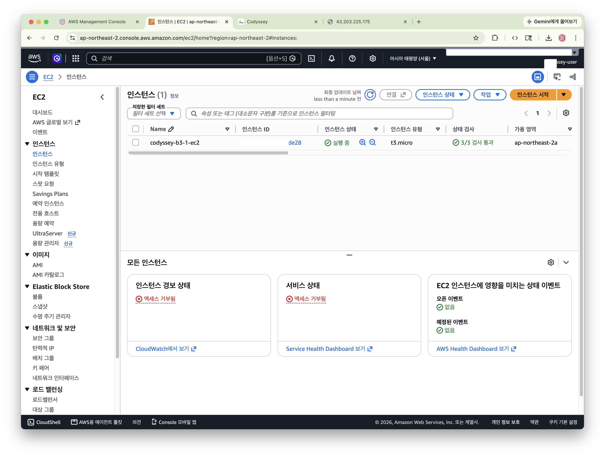
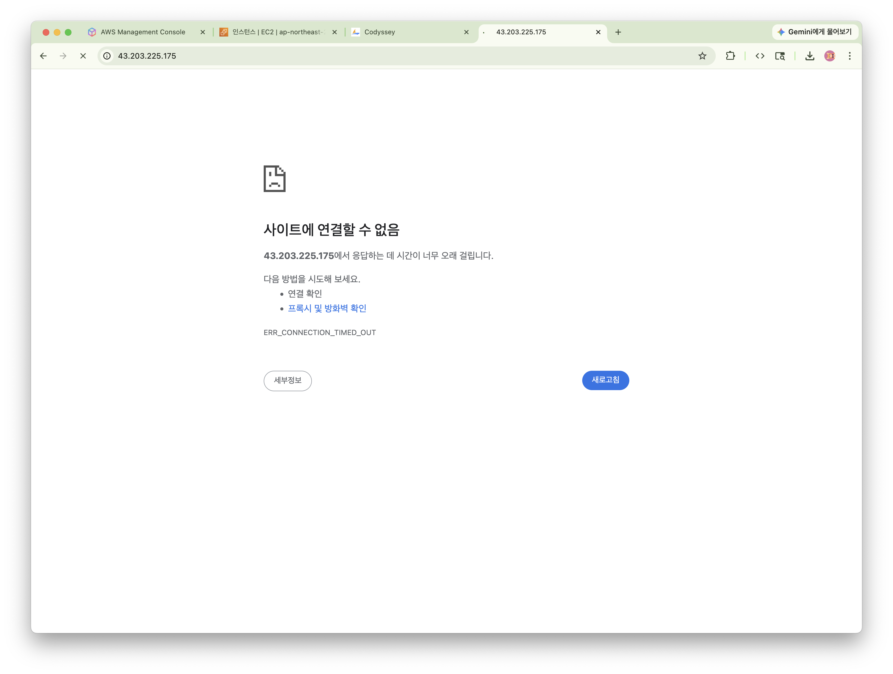
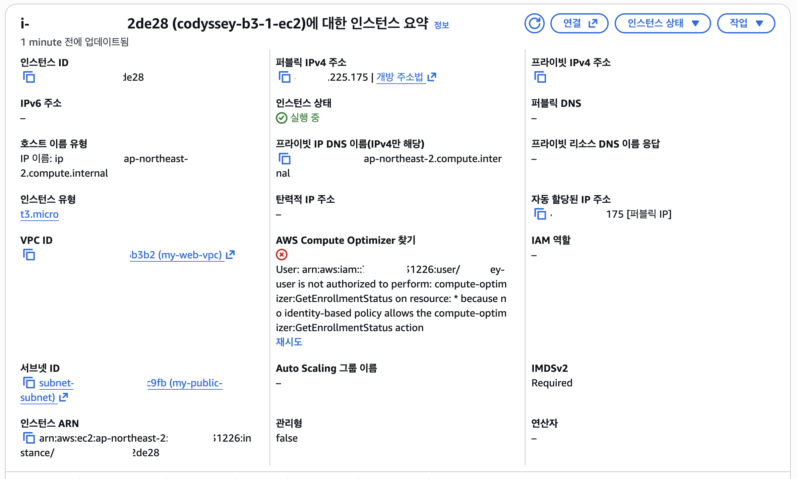
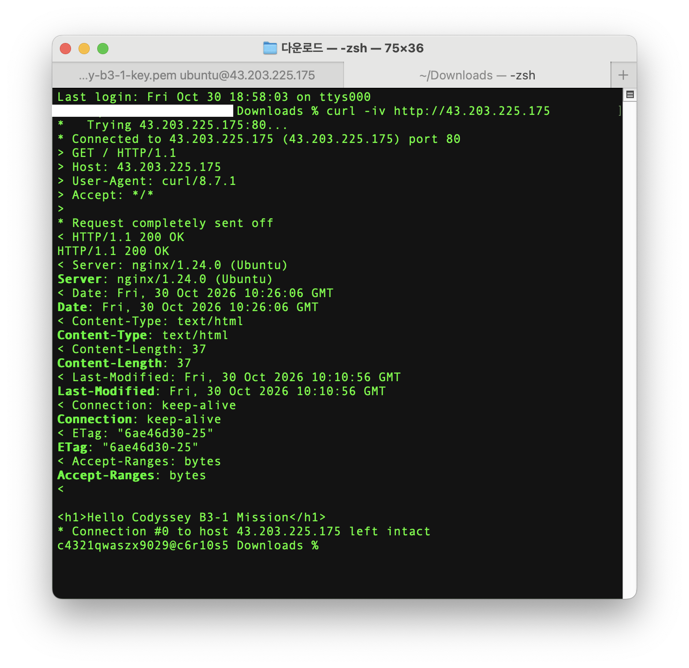
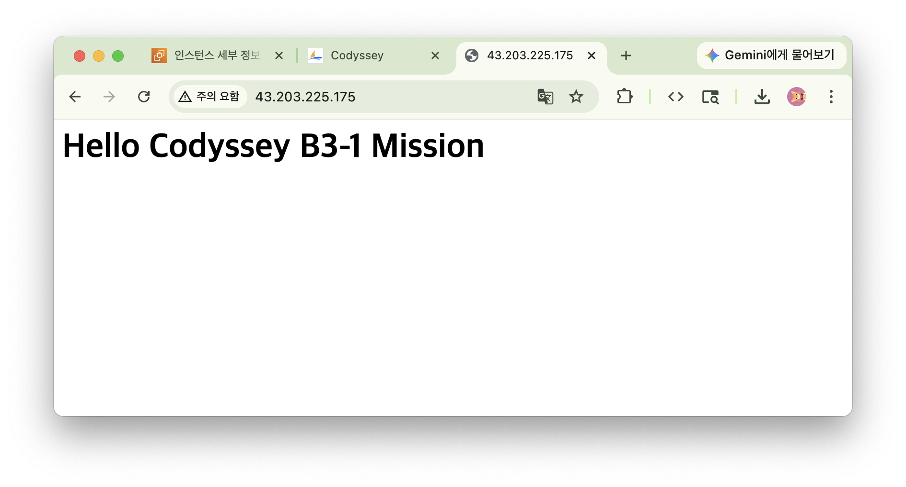

# 🛠️ 트러블슈팅 보고서 (Troubleshooting Report)

## 요약 테이블

| 항목 | 내용 |
| :--- | :--- |
| **증상 (문제 상황)** | 처음 퍼블릭 IP(`43.203.225.175`)로 접속했을 때는 정상 작동했으나, 몇 번의 새로고침 후 더 이상 응답이 없으며 **`ERR_CONNECTION_TIMED_OUT` (사이트에 연결할 수 없음)** 오류 발생 |
| **원인 가설** | 1) EC2 인스턴스 상태 이상 또는 웹 서버(Nginx) 프로세스 중단<br/>2) 보안 그룹(Security Group) 인바운드 규칙에 HTTP(80) 포트 미허용<br/>3) 브라우저 새로고침 과정에서 요청 프로토콜이 `http://`(80 포트)가 아닌 **`https://`(443 포트)**로 전환되어 보안 그룹에서 차단됨 |
| **검증 방법** | 1) AWS 콘솔의 **'개방 주소법(Open address)'** 링크로 접속 테스트 (동일하게 열리지 않음 확인 — `https://`로 연결됨)<br/>2) EC2 보안 그룹 인바운드 규칙 확인 (`80/TCP`, `22/TCP` 정상 허용 확인)<br/>3) 로컬 PC 터미널에서 `curl -iv http://43.203.225.175` 명령어로 80번 포트 직접 호출 테스트 (`200 OK` 확인) |
| **조치 내용** | 크롬 브라우저 주소창에 `https://` 없이 퍼블릭 IPv4 주소(**`http://43.203.225.175`**)만 입력하여 80번 포트로 접속 |
| **결과** | `HTTP/1.1 200 OK` 응답과 함께 웹 페이지(`Hello Codyssey B3-1 Mission`) 정상 출력 확인 |
| **재발 방지** | 1) SSL/TLS 인증서(443 포트) 미적용 환경에서는 브라우저의 HTTPS 자동 전환 및 콘솔 '개방 주소법'(`https://` 기본 연결)에 주의하여 `http://` 프로토콜로 접속<br/>2) 브라우저 접속 실패 시 `curl -iv`를 먼저 실행해 인프라(서버/보안그룹) 문제인지 클라이언트 프로토콜(HTTP/HTTPS) 문제인지 즉시 분리 진단 |

---

## 상세 분석 및 해결 과정

### 1. 증상 (문제 상황)

EC2 인스턴스(`codyssey-b3-1-ec2`, 퍼블릭 IP: `43.203.225.175`)에 Nginx를 설치한 뒤, 처음 크롬 브라우저에서 해당 퍼블릭 IP로 접속했을 때는 웹 페이지가 정상적으로 작동했습니다.

그러나 몇 번 새로고침을 한 뒤부터 갑자기 더 이상 응답이 없었으며, 아래와 같이 응답 시간이 초과되어 **`ERR_CONNECTION_TIMED_OUT` (사이트에 연결할 수 없음)** 오류가 발생했습니다.

* **인스턴스 실행 상태 확인 (`Trouble-1.png`)**
  

* **몇 번의 새로고침 후 브라우저 접속 타임아웃 증상 (`Trouble-2.png`)**
  

---

### 2. 원인 가설 수립

처음에는 되다가 새로고침 후 타임아웃(`ERR_CONNECTION_TIMED_OUT`)이 발생하는 원인으로 다음 3가지 가설을 세웠습니다.

1. **가설 1 (인스턴스/웹 서버 이상)**: EC2 인스턴스에 문제가 생겼거나 내부 Nginx 프로세스가 중단되었을 것이다.
   * *기각 근거*: AWS 콘솔 확인 결과 인스턴스는 `실행 중` 및 `3/3 검사 통과` 상태였으며, SSH 연결 및 내부 `curl -i http://localhost` 응답도 정상이었음.
2. **가설 2 (보안 그룹 설정 문제)**: EC2에 연결된 보안 그룹(Security Group) 인바운드 규칙에서 HTTP(80번 포트)가 제대로 열려 있지 않을 것이다.
3. **가설 3 (프로토콜/포트 불일치 문제)**: 브라우저에서 새로고침하는 과정에서 요청이 `http://`(80번 포트)가 아닌 **`https://`(443번 포트)**로 전환되어, 보안 그룹에서 허용하지 않은 443번 포트로 패킷이 전송되고 있을 것이다.

---

### 3. 검증 과정

#### 3-1. AWS 콘솔의 '개방 주소법(Open address)'으로 접속 확인
AWS EC2 콘솔의 인스턴스 요약 화면에서 퍼블릭 IPv4 주소 옆의 **`개방 주소법 ↗`** 링크를 클릭하여 열어본 결과, 동일하게 페이지가 열리지 않고 타임아웃이 발생했습니다. 확인 결과 AWS 콘솔의 '개방 주소법' 링크는 기본적으로 `http://`가 아닌 **`https://43.203.225.175` (443번 포트)**로 브라우저를 연결하는 동작 방식을 가지고 있었습니다.

* **AWS 콘솔 '개방 주소법' 확인 (`Trouble-3.png`)**
  

#### 3-2. EC2 보안 그룹(Security Group) 인바운드 규칙 확인 (가설 2 검증)
AWS 콘솔에서 EC2 인스턴스의 보안 그룹 인바운드 규칙을 확인한 결과, 아래와 같이 **HTTP(80번 포트)는 모든 IP(`0.0.0.0/0`)에 대해 정상적으로 열려 있음**을 확인했습니다. 반면 HTTPS(443번 포트) 규칙은 열려 있지 않습니다.

| 포트 범위 | 프로토콜 | 원본 (Source) | 설명 |
| :---: | :---: | :--- | :--- |
| **80** | TCP | `0.0.0.0/0` | 웹 서비스 외부 HTTP 접속 허용 |
| **22** | TCP | `121.135.xxx.xxx/32` | 관리자 개인 IP에서만 SSH 접속 허용 |

#### 3-3. 로컬 터미널에서 `curl -iv`로 80번 포트 직접 호출 (가설 3 검증)
브라우저의 `https://` 자동 전환 영향을 배제하기 위해, 로컬 Mac 터미널에서 명시적으로 `http://`(80번 포트)를 지정하여 요청을 보냈습니다.

```text
>>> user@local Downloads % curl -iv http://43.203.225.175
*   Trying 43.203.225.175:80...
* Connected to 43.203.225.175 (43.203.225.175) port 80
> GET / HTTP/1.1
> Host: 43.203.225.175
> User-Agent: curl/8.7.1
> Accept: */*
> 
* Request completely sent off
< HTTP/1.1 200 OK
HTTP/1.1 200 OK
< Server: nginx/1.24.0 (Ubuntu)
Server: nginx/1.24.0 (Ubuntu)
< Date: Fri, 30 Oct 2026 10:26:06 GMT
Date: Fri, 30 Oct 2026 10:26:06 GMT
< Content-Type: text/html
Content-Type: text/html
< Content-Length: 37
Content-Length: 37
< Last-Modified: Fri, 30 Oct 2026 10:10:56 GMT
Last-Modified: Fri, 30 Oct 2026 10:10:56 GMT
< Connection: keep-alive
Connection: keep-alive
< ETag: "6ae46d30-25"
ETag: "6ae46d30-25"
< Accept-Ranges: bytes
Accept-Ranges: bytes
< 

<h1>Hello Codyssey B3-1 Mission</h1>
* Connection #0 to host 43.203.225.175 left intact
```

* **`curl -iv` 검증 결과 스크린샷 (`Solution-1.png`)**
  

**검증 결론**:
* 로컬 터미널에서 80번 포트로 요청했을 때는 지연 없이 즉시 `Connected to 43.203.225.175 port 80` 및 `HTTP/1.1 200 OK` 응답이 돌아왔습니다.
* 즉, 서버와 보안 그룹의 80번 포트는 정상 동작 중이었으며, 브라우저 새로고침 또는 콘솔 '개방 주소법' 링크 사용 시 **`https://43.203.225.175`(443번 포트)로 접속이 시도**되면서 보안 그룹에서 패킷이 차단(Drop)되어 `ERR_CONNECTION_TIMED_OUT`이 발생한 것임이 검증되었습니다 (**가설 3 채택**).

---

### 4. 조치 내용

크롬 브라우저 주소창에서 `https://`를 제거하고, 퍼블릭 IPv4 주소(**`43.203.225.175`** 또는 **`http://43.203.225.175`**)만 입력하여 80번 포트로 접속하도록 조치했습니다.

---

### 5. 결과

크롬 브라우저에서 `https://` 없이 퍼블릭 IPv4 주소로 접속하자 타임아웃 없이 즉시 **`Hello Codyssey B3-1 Mission`** 웹 페이지가 정상적으로 출력되었습니다.

* **브라우저 정상 접속 확인 (`web-connect.png`)**
  

---

### 6. 재발 방지 대책

1. **브라우저의 HTTPS 자동 전환 및 콘솔 '개방 주소법' 동작 주의**:
   * 최신 브라우저는 새로고침 시 `https://`로 연결을 업그레이드하려 시도할 수 있으며, AWS 콘솔의 `개방 주소법(Open address)` 역시 기본적으로 `https://`(443 포트)로 탭을 엽니다. SSL 인증서(443 포트)를 구성하지 않은 HTTP 전용(80 포트) 환경에서는 주소창에 `https://`가 붙지 않았는지 먼저 확인합니다.
2. **계층별 트러블슈팅 진단 순서 표준화**:
   * 브라우저에서 접속 타임아웃이 발생할 때 로컬 터미널에서 `curl -iv http://<IP>`를 먼저 실행하여 **서버/보안그룹 문제인지 브라우저의 프로토콜(HTTP/HTTPS) 문제인지 즉시 분리 진단**합니다.
